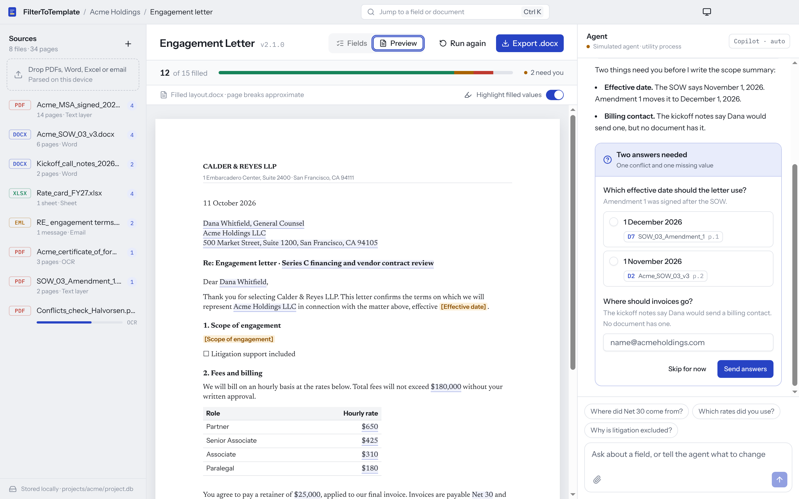

# FilterToTemplate

A desktop app that fills team-designed templates from many uploaded documents. A GitHub Copilot SDK agent extracts each field with a cited source, asks the user follow-up questions for anything missing or conflicting, and renders the finished document.

- **Research:** [`reports/Copilot SDK template filler stack.md`](reports/Copilot%20SDK%20template%20filler%20stack.md) covers the recommended stack, template design, risks and a phased build plan. The source notes are in [`research_notes/`](research_notes/).
- **Prototype:** [`apps/desktop`](apps/desktop) is a runnable UI on that stack. The agent is simulated, so it runs without a Copilot sign-in.


## Direction

- **Base: Workbench** (`variants/workbench`). Sources, fields and agent side by side. This is the design the round-two prototypes build on.
- **V2: Tray** (`variants/tray`). Workbench with the follow-up questions moved out of the chat into a tray pinned above the fields, and a sources panel that folds into a rail and wakes up when the agent reads or cites a document.

The other prototypes stay in the app for reference.

## Prototypes

The app ships several layout prototypes over the same agent, fill state and Word render. Switch between them with the bar at the top, `Alt+1`…`Alt+7` (Base, V2 and the round-three prototypes), the command menu (`Ctrl/⌘ K`), or a URL hash such as `#tray`. The reset button puts the example back to its opening state.

| # | Prototype | Idea |
|---|---|---|
| 0 | Workbench (Base) | The original: sources, fields and agent side by side |
| 1 | Canvas | The letter is the interface; edit and verify values on the page |
| 2 | Steps | A guided flow that asks for one decision at a time |
| 3 | Chat | Conversation-first; the document opens beside it |
| 4 | Triage | Keyboard-driven review of each value against its evidence |
| 5 | Grid | One dense sheet with bulk actions, for large templates |
| 6 | Tray (V2) | Workbench with questions pinned above the fields and a sources rail that wakes when the agent reads |
| 7 | In place | Workbench with questions answered inside the field rows and an evidence pane that follows your focus |
| 8 | Sidekick | Workbench without the left pane; one side panel with Needs you, Agent and Sources tabs |
| 9 | Dock | Workbench with sources in a dock along the bottom and questions as one focused card |
| 10 | Phases | Workbench whose left column follows the job: reading, then questions, then review |
| 11 | Evidence | V2 whose left rail opens into evidence for the field you select |
| 12 | Split | V2 with the live Word letter beside the fields and the agent as a drawer |
| 13 | Review | V2 whose tray carries you through questions, then review, then export |
| 14 | Focus | V2 with finished sections folded away and a floating agent composer |
| 15 | Trail | V2 with an activity trail in the rail and a history on every value |

Round 2 (6–10) refines Workbench: follow-up questions move out of the chat, and sources come alive only when they matter. Round 3 (11–15) spins off from Tray (V2): each starts from the whole Tray prototype and pushes one idea further. The switcher shows Base, V2 and the round-three prototypes up front; earlier rounds are in its Earlier menu. Each prototype lives in `apps/desktop/src/renderer/src/variants/<id>/`.

## Run the prototype

Requires Node 24 (`.nvmrc`) and pnpm 10.

```sh
pnpm install
pnpm dev          # Electron with hot reload
pnpm build:web    # apps/desktop/dist-web/index.html, a single-file browser build
```

Other scripts, run inside `apps/desktop`:

```sh
pnpm typecheck
pnpm template:check           # layout.docx tags match the field definitions; a full render leaves nothing unfilled
pnpm template:build           # regenerate the sample layout.docx
pnpm build && pnpm test:e2e   # Playwright drives the built Electron app, including a real .docx export
```

On Linux CI or containers, wrap the e2e run in `xvfb-run`. Set `SCREENSHOT_DIR` to save screenshots of each step.

## What's in the prototype

| Layer | Used here |
|---|---|
| Shell | Electron 44.7 (Node 24.21, Chromium 152) built with electron-vite 5 |
| Processes | Thin main process, sandboxed renderer, agent in a `utilityProcess` streaming over a `MessagePort` |
| UI | React 19.3, Tailwind 4.3, shadcn/ui on Radix, Zustand, cmdk (Ctrl/⌘ K), sonner, react-dropzone |
| Chat | AI SDK v7 `useChat` with a custom transport over the agent port, AI Elements (Conversation, Message, Tool, Shimmer), Streamdown |
| Agent contract | `src/shared/protocol.ts`: fill-state types, follow-up question sets, and a zod-validated worker protocol |
| Agent | `src/agent-core/demo-engine.ts`: a scripted stand-in that emits the same UI message chunks a Copilot SDK session adapter would |
| Word output | `templates/engagement-letter/layout.docx` filled by docxtemplater (`src/doc-engine/render.ts`), previewed with docx-preview, exported as a real `.docx` |

The example project is an engagement letter for a fictional client, filled from eight invented documents. You can:

- open any citation to see the quote highlighted on its source page;
- answer the agent's follow-up form and watch it write the scope summary;
- edit a field inline, which locks it against agent overwrites;
- approve sections;
- switch to the Word preview, where filled values are underlined, missing ones show as placeholders, and clicking a value jumps to its field;
- export the filled `.docx`;
- drop files to watch simulated ingest;
- re-run the whole fill from scratch.

| Source viewer | Agent writing | Word preview |
|---|---|---|
|  |  |  |

## Word templates

Each template is a Word file the team authors and brands in Word, plus the field definitions the agent fills. Tags such as `{client.name}`, the loop pair `{#hourlyRates}…{/hourlyRates}` across a table row, and `{#scopeParagraphs}{text}{/scopeParagraphs}` for AI-written paragraphs mark where values go.

The same render produces the preview and the export. The preview render wraps each value in invisible markers, and the app turns those into clickable highlights after docx-preview draws the page. The exported file never contains them. docx-preview doesn't paginate like Word, so page breaks in the preview are approximate. For exact pages, the full build would add a PDF view rendered by LibreOffice.

| Gaps before answers | Filled |
|---|---|
|  |  |

## Not built yet

- **Copilot SDK.** Replace `demo-engine.ts` with a `CopilotClient` session in `agent-worker.ts`, using `mode: "empty"`, the custom tools, and `ask_user` elicitation. The transport and UI stay as they are.
- **Document parsing.** unpdf, mammoth, SheetJS and tesseract.js in ingest workers, with SQLite FTS5 under `userData`.
- **Template authoring.** Import a team-written `layout.docx`, generate starter field definitions from its tags, and keep them in `schema.json`. Add PDF export through LibreOffice.
- **Packaging.** electron-builder, signing, notarization and auto-update.
