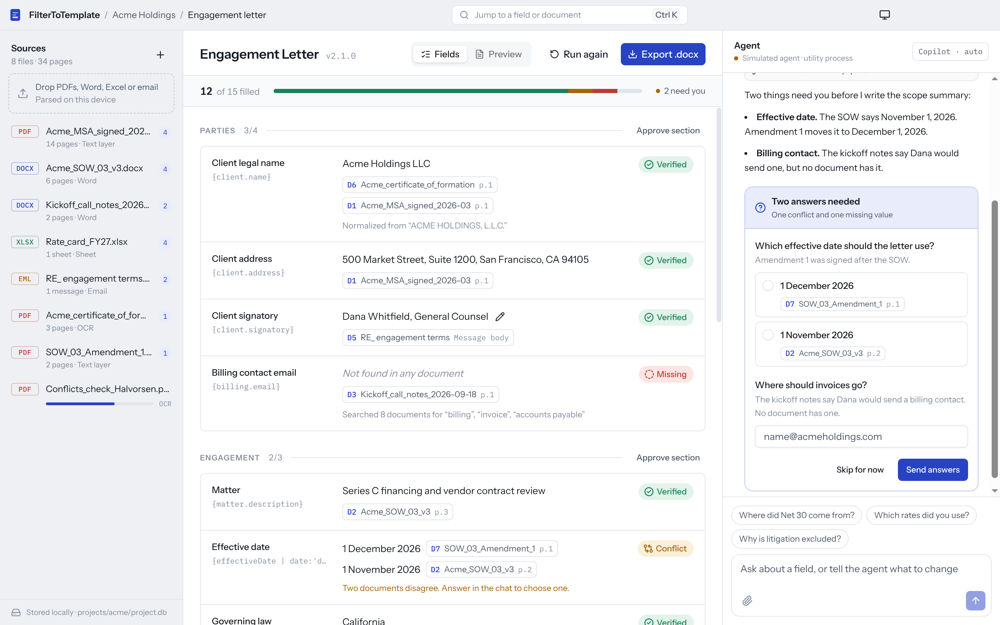
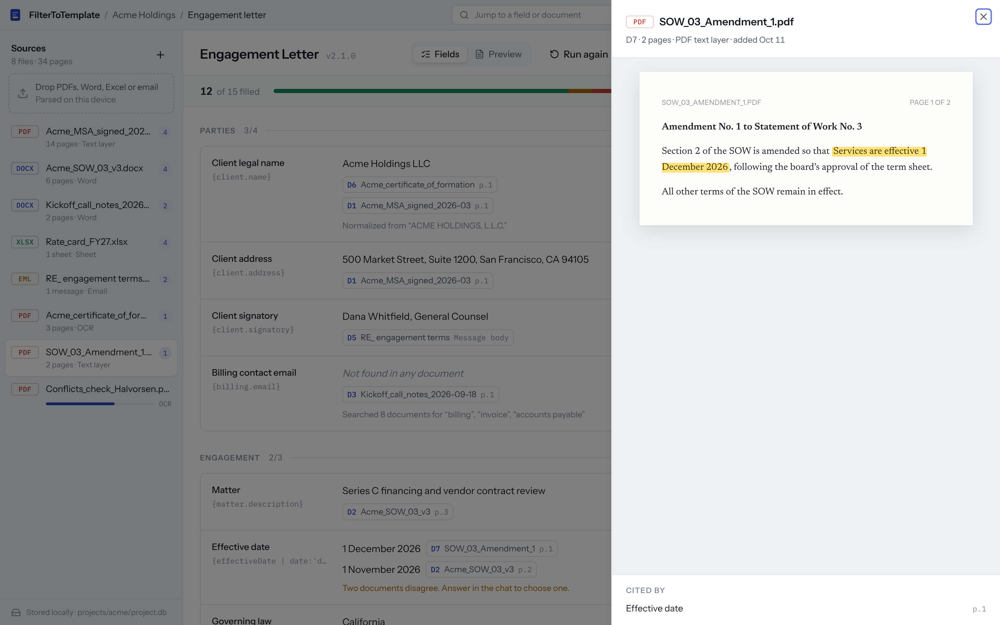
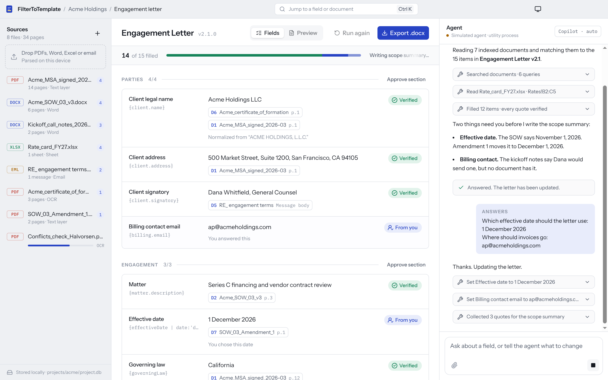
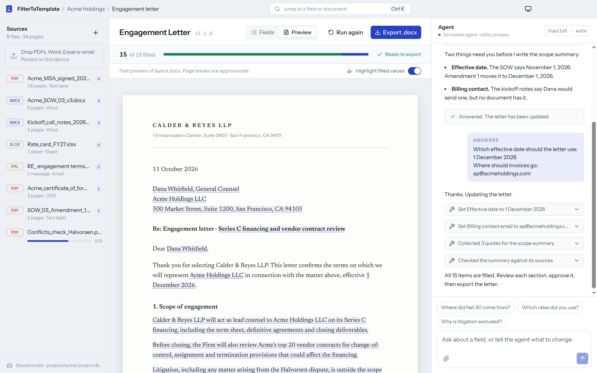

# FilterToTemplate

A desktop app that fills team-designed templates from many uploaded documents. A GitHub Copilot SDK agent extracts each field with a cited source, asks the user follow-up questions for anything missing or conflicting, and renders the finished document.

- **Research:** [`reports/Copilot SDK template filler stack.md`](reports/Copilot%20SDK%20template%20filler%20stack.md) covers the recommended stack, template design, risks and a phased build plan. The source notes are in [`research_notes/`](research_notes/).
- **Prototype:** [`apps/desktop`](apps/desktop) is a runnable UI on that stack. The agent is simulated, so it runs without a Copilot sign-in.



## Run the prototype

Requires Node 24 (`.nvmrc`) and pnpm 10.

```sh
pnpm install
pnpm dev          # Electron with hot reload
pnpm build:web    # apps/desktop/dist-web/index.html, a single-file browser build
```

Other scripts, run inside `apps/desktop`:

```sh
pnpm typecheck
pnpm build && pnpm test:e2e   # Playwright drives the built Electron app
```

On Linux CI or containers, wrap the e2e run in `xvfb-run`. Set `SCREENSHOT_DIR` to save screenshots of each step.

## What's in the prototype

| Layer | Used here |
|---|---|
| Shell | Electron 44.7 (Node 24.21, Chromium 152) built with electron-vite 5 |
| Processes | Thin main process, sandboxed renderer, agent in a `utilityProcess` streaming over a `MessagePort` |
| UI | React 19.3, Tailwind 4.3, shadcn/ui on Radix, Zustand, cmdk (Ctrl/⌘ K), sonner, react-dropzone |
| Chat | AI SDK v7 `useChat` with a custom transport over the agent port, AI Elements (Conversation, Message, Tool, Shimmer), Streamdown |
| Agent contract | `src/shared/protocol.ts`: fill-state types, follow-up question sets, and a zod-validated worker protocol |
| Agent | `src/agent-core/demo-engine.ts`: a scripted stand-in that emits the same UI message chunks a Copilot SDK session adapter would |

The example project is an engagement letter for a fictional client, filled from eight invented documents. You can:

- open any citation to see the quote highlighted on its source page;
- answer the agent's follow-up form and watch it write the scope summary;
- edit a field inline, which locks it against agent overwrites;
- approve sections;
- switch to the letter preview;
- drop files to watch simulated ingest;
- re-run the whole fill from scratch.

| Source viewer | Agent writing | Letter preview |
|---|---|---|
|  |  |  |

## Not built yet

- **Copilot SDK.** Replace `demo-engine.ts` with a `CopilotClient` session in `agent-worker.ts`, using `mode: "empty"`, the custom tools, and `ask_user` elicitation. The transport and UI stay as they are.
- **Document parsing.** unpdf, mammoth, SheetJS and tesseract.js in ingest workers, with SQLite FTS5 under `userData`.
- **Template rendering.** docxtemplater against a real `layout.docx` plus `schema.json`, with export to `.docx` and PDF.
- **Packaging.** electron-builder, signing, notarization and auto-update.
