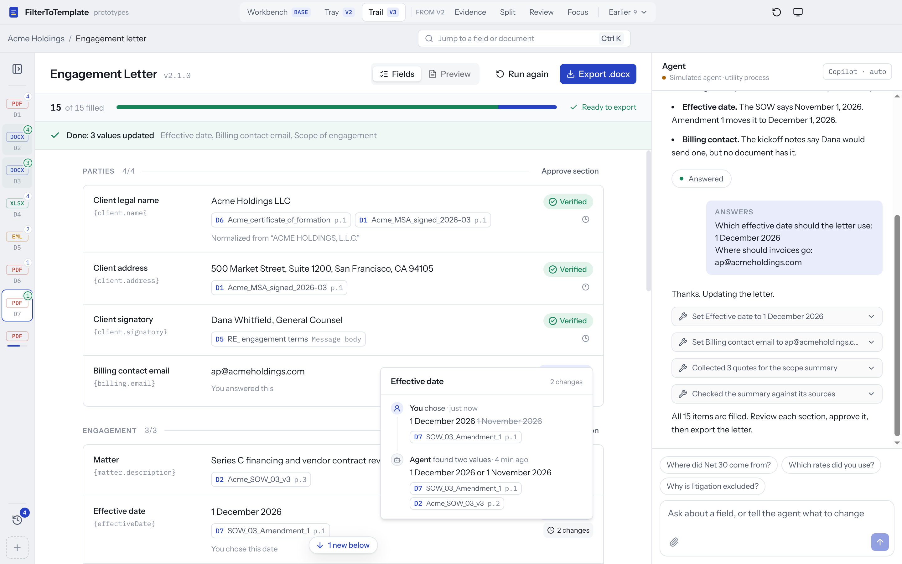

# Tech stack

FilterToTemplate is a desktop app. Users upload many documents. A GitHub Copilot SDK agent fills a template the team designs, cites a source for every value, and asks follow-up questions about anything missing or conflicting. The output is a Word document.

This page is the short version of the stack. The full reasoning, with citations, is in [`reports/Copilot SDK template filler stack.md`](../reports/Copilot%20SDK%20template%20filler%20stack.md).

**Chosen design: Trail (V3)** (`apps/desktop/src/renderer/src/variants/tray-trail`). It builds on Tray (V2):
- Follow-up questions wait in a tray above the fields.
- Sources fold into a rail that wakes when the agent reads a document.
- The rail opens onto a timeline of what the agent and the user did.
- Every value has a history with undo, and values that changed while you were away say so.



## At a glance

Versions were current on 2026-10-11. "In the repo" says whether the prototype already uses it.

| Layer | Choice | In the repo |
|---|---|---|
| Runtime | Node 24 LTS, as embedded by Electron (24.21) | Yes |
| Desktop shell | Electron 44.7, moving to 45 after it ships on 2026-10-20 | Yes |
| Build | electron-vite 5 (Vite 7) | Yes |
| Packaging and updates | electron-builder 26 and electron-updater 6 | Not yet |
| Process model | Thin main process, sandboxed renderer, agent in a `utilityProcess` streaming over a `MessagePort`, and a pool of ingest workers | Yes, except the ingest workers |
| IPC contract | Hand-written zod 4 schemas (`src/shared/protocol.ts`) | Yes |
| UI | React 19.3, TypeScript, Tailwind CSS 4.3, shadcn/ui on Radix | Yes |
| Polish | Zustand 5, Motion 14, cmdk (Ctrl/⌘ K), sonner, react-dropzone, lucide | Yes |
| Chat | AI SDK v7 `useChat` with a custom transport over the agent port, AI Elements, Streamdown 2.7 | Yes |
| Agent | `@github/copilot-sdk`, pinned to an exact version, with `mode: "empty"`, the app's own tools, and `ask_user` in its elicitation variant | Simulated by `src/agent-core/demo-engine.ts` |
| Sign-in | "Sign in with GitHub" for Copilot seats, plus "Use your own key" (BYOK) | Not yet |
| Document parsing | unpdf (PDF.js), mammoth + turndown, SheetJS CE from its CDN, PostalMime / msgreader, tesseract.js 7 for OCR | Simulated |
| Hard pages | Copilot vision on page images; opt-in Mistral OCR or Azure Document Intelligence | Not yet |
| Search | SQLite FTS5 first; sqlite-vec embeddings only if evals show keyword misses | Not yet |
| Storage | `node:sqlite` with one database per project under `userData`; content-addressed files; `safeStorage` for tokens and keys | Not yet |
| Templates | A Word `layout.docx` the team authors, filled by docxtemplater 3.71 with angular-expressions and InspectModule, plus a JSON Schema contract | Yes, with a sample template and a tag check |
| Preview | docx-preview, with each value clickable back to its field | Yes |
| Output | `.docx` natively; PDF through LibreOffice headless if needed | `.docx` yes, PDF not yet |
| Signing | Apple Developer ID and notarization; Azure Artifact Signing on Windows | Not yet |
| Tests and evals | Playwright `_electron` end-to-end, Vitest, and 20–50 golden document bundles scored per field | Playwright yes |
| Repo | pnpm workspaces: `apps/desktop` now, with `packages/{ipc-contract, agent-core, doc-engine, ui}` to split out | Partly: `agent-core`, `doc-engine` and the shared contract are folders inside `apps/desktop/src` for now |

## How the pieces fit

```
main process        windows, OAuth + safeStorage, auto-updater, save dialogs, MessagePort broker
 ├─ renderer        React UI (Trail), sandboxed; talks to the agent over a MessagePort
 ├─ agent worker    utilityProcess: CopilotClient, the app's tools, question queue, orchestrator
 │   └─ copilot-runtime   process the SDK spawns and drives over stdio
 └─ ingest workers  utilityProcess pool: parsers, OCR, page images, indexing
state on disk       userData/projects/<id>/project.db   documents, blocks + FTS5, fill state, questions, activity
                    userData/projects/<id>/files/<sha256>.<ext>, outputs/
```

The renderer never touches the agent directly. In the prototype, `src/main/agent-worker.ts` hosts the simulated engine behind the same port and message shapes the Copilot SDK adapter will use, so the UI does not change when the real agent goes in.

## The agent

- **Locked down.** Run the Copilot SDK with `mode: "empty"`, so the agent gets only the app's tools, with none of its coding defaults or file access.
- **Small, checked writes.** The agent fills one field at a time through a `set_field` tool. That tool rejects any value whose quote cannot be found in the cited document.
- **Questions come from gaps the app can see.** After each pass, code turns every missing or conflicting field into a question in the tray. The SDK's elicitation tool is a second source of questions, for clarifications the agent needs mid-run. Both write answers through the same path, so a value you supplied looks the same in the history either way.
- **The conversation is disposable; the fill state is durable.** Sessions can be compacted or lost, so the agent re-reads the fill state from SQLite whenever it resumes.
- **Guardrails through hooks.** `onAgentStop` blocks stopping while required fields are empty and not marked missing. `onPreToolUse` blocks writes to fields the user has locked.

## Templates and Word output

- **Authored in Word.** The team designs and brands each template in Word. Tags such as `{client.name}`, a table-row loop `{#hourlyRates}…{/hourlyRates}`, and `{#scopeParagraphs}{text}{/scopeParagraphs}` for AI-written paragraphs mark where values go.
- **One JSON Schema per template.** Field types, prompts, review forms, validation, follow-up questions and eval metrics all come from it.
- **Kept in sync.** `pnpm template:check` uses InspectModule to confirm the layout's tags match the field definitions, and that a full render leaves nothing unfilled.
- **One render for preview and export.** The preview wraps each value in invisible markers that become clickable highlights; the exported file never contains them.
- **Page breaks.** docx-preview doesn't paginate like Word, so for exact pages add a PDF view rendered by LibreOffice.

## Trail on this stack

Trail adds one thing the other designs don't need: a durable record of every change.

- **In the prototype.** The trail is built in the renderer (`variants/tray-trail/trail.ts`). It is derived from the chat's tool calls and from changes to the shared fill state, and it lasts only as long as the window is open. The footer's "Stored locally · projects/acme/project.db" is a placeholder.
- **In the full build:**
  - Store each change as a row in an append-only `activity` table in `project.db`. A row records the time, the actor (agent or user), the field, the value before and after, the sources, and the session turn.
  - The agent worker writes the agent's changes. The main process writes the user's edits, answers and approvals.
  - The timeline, each value's history and undo all read from that table, so they survive restarts.
  - Undo writes a new row rather than deleting one, so the record doubles as an audit log of who set each value and from which page.
  - The "New" markers come from comparing each row's time with when the user last viewed that field.

## Packaging and shipping

- **The Copilot runtime is big.** It is about 130 MB per platform and has to stay outside the asar archive. Point the SDK at the unpacked copy, and keep its session data under `userData`.
- **Signing.** Sign and notarize every binary on macOS, including the runtime. Use Azure Artifact Signing on Windows ($9.99 a month).
- **Installers.** NSIS on Windows, DMG and ZIP on macOS, with separate arm64 and x64 builds. Expect about 150–250 MB per architecture.
- **Hardening.** Use `@electron/fuses` to turn off RunAsNode and inspector flags in production builds, and turn on asar integrity checks.

## What's built and what's next

**Built:** the Electron shell and process model, the full Trail UI and the earlier prototypes, the chat transport, the fill-state model, a real Word template with preview and `.docx` export, and end-to-end tests that drive the built app.

**Next, in order:**

1. **De-risking spike.** Get the pinned Copilot SDK running from the packaged app on each OS, with signed installers, GitHub sign-in, BYOK, and an elicitation round trip to the tray.
2. **Vertical slice.** Real parsing for PDF and DOCX into SQLite FTS5, the agent's tools with quote-checked `set_field`, Trail's activity table, and a first golden set of about 20 document bundles.
3. **Gaps and questions.** Question generation from fill state, conflict handling, user locks, and the stop-hook diligence check.
4. **Breadth and authoring.** XLSX, email and OCR inputs, template import that generates the starter schema, and PDF output.
5. **Ship.** Auto-update channels, opt-in telemetry, and CI gated on the golden-set scores.

## Open questions

Answers to these would change parts of the stack. The full list is at the end of the report.

- **Do recipients need DOCX, PDF or both?** PDF only would let the app drop Word templates for HTML ones.
- **Do most users have Copilot seats?** If not, BYOK becomes the main sign-in, and a lighter agent SDK starts to look better.
- **May documents leave the device?** If not, use local models through BYOK and no cloud parsing.
- **Who authors templates?** Non-developers need an import wizard and a schema editor. Developers can keep templates as files in Git.
- **Is the app sold to customers?** If so, the licensing for docxtemplater and the Copilot runtime, and the Copilot terms of service, need legal review.
